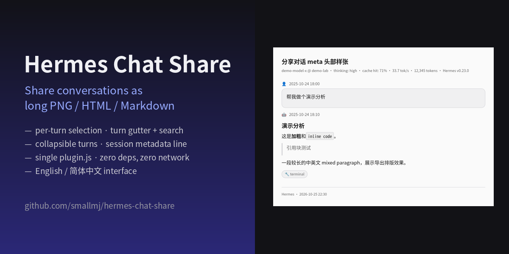
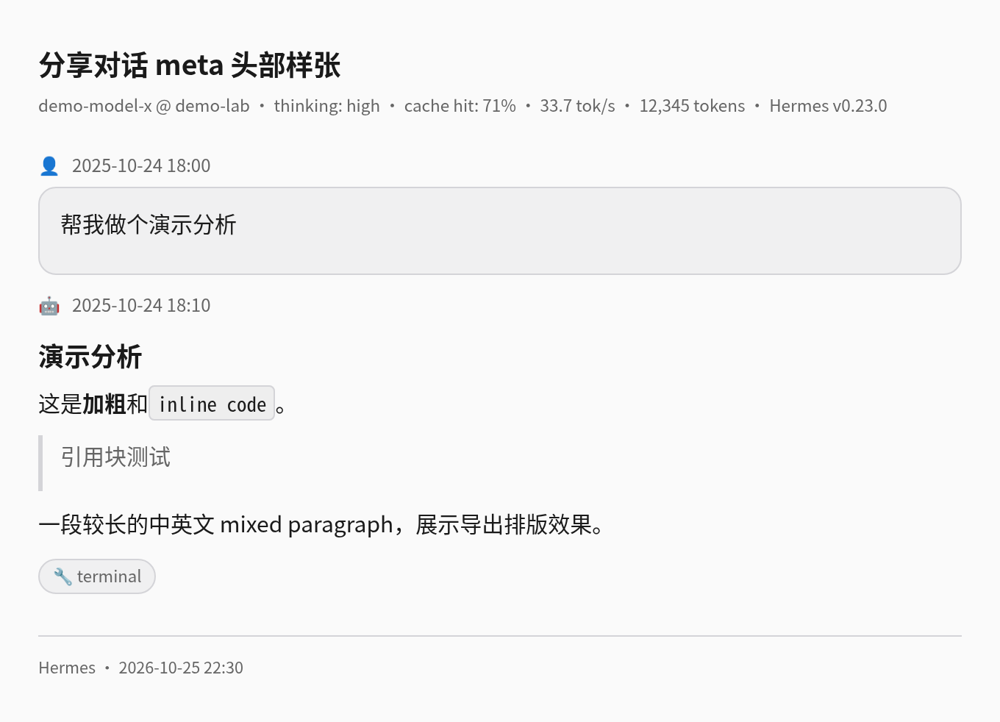

# Hermes Chat Share（对话分享）

[English](README.md) · **简体中文**



把 Hermes 桌面端对话按轮次多选，导出为 **长截图 PNG / 自包含 HTML / Markdown**——对标 [dsh-share](https://github.com/hellodigua/dsh-share) 的体验，但长在 Hermes Desktop 里。单文件桌面插件：零依赖、零联网、无需构建。



## 安装

> ✅ 已正式收录进 **Hermes Agent 官方插件目录**（community 层级）——经 [NousResearch/hermes-agent#144552](https://github.com/NousResearch/hermes-agent/pull/144552) 合并，v1.1.8 更新经 [#146455](https://github.com/NousResearch/hermes-agent/pull/146455) 提交，官方文档页：[hermes-agent.nousresearch.com/docs/plugins/hermes-chat-share](https://hermes-agent.nousresearch.com/docs/plugins/hermes-chat-share)。

**方式一：桌面插件市场（推荐）**

Hermes Desktop → **Capabilities → Plugins** → 搜索 **「Chat Share」** → **Install**。版本由官方目录钉定，完整性有校验。

**方式二：从 Git 安装**

Hermes Desktop → **Capabilities → Plugins → Install from Git** → 填：

```
smallmj/hermes-chat-share
```

勾选 **Desktop UI** 组件，完成——每个对话的标题栏会多出分享图标。或直接点[一键安装链接](hermes://plugin/install?repo=smallmj/hermes-chat-share)。

<details>
<summary>手动安装</summary>

把本仓库 `desktop/plugin.js` 放进**运行桌面 App 的那台机器**的插件目录（文件夹名必须是 `hermes-chat-share`）：

- macOS / Linux：`~/.hermes/desktop-plugins/hermes-chat-share/plugin.js`
- Windows：`%LOCALAPPDATA%\hermes\desktop-plugins\hermes-chat-share\plugin.js`

页面没出现就 `⌘K / Ctrl+K` → `Reload desktop plugins`；开关在 Capabilities → Plugins。
</details>

## 功能

**四个入口**——每个对话标题栏的分享图标（点谁的图标就是谁的分享页）、侧边栏页面、命令面板（`分享对话`）、快捷键 `Ctrl/Cmd+Shift+H`。页面自动跟随你切换的对话，没有刷新按钮，不会残留旧会话。

**为长对话而生**
- **轮次刻度条**：右侧分格导航，一轮一刻度，悬停预览问题内容，点击直达该轮；**在刻度上拖拽即可一次选中一段连续轮次**。
- **搜索**：匹配问题与回复全文，`Enter` / `Shift+Enter` / ↑↓ 在结果间循环跳转（`3/17` 计数），命中的轮自动展开并高亮描边。
- **逐轮折叠**：每轮默认只显示你的问题和最终回复，「展开（N 条中间回复 · M 个工具调用）」按需展开，各轮独立。
- **分享范围开关**：取消勾选「分享完整对话」后，**所有导出**都只含问题+最终回复——所见即所得。

**诚实的会话元数据**——模型与提供方、思考等级、缓存命中率、输出速度 tok/s、总 tokens、Hermes 版本，进入页面头部和每种导出；取自网关的真实数据面——`session.usage` RPC 与 `session.info` 网关事件，缺字段就省略，绝不编造。不想暴露模型信息？**「会话信息」开关一键隐藏**，导出标题也可**点击即改**。

**导出**
- **PNG 长图**：宽 680/880/1080px、字号三档、2× 高清，配色实时快照当前 App 主题（深浅色都对）。**单条超长回复自动跨页拆分**，几千行的日志刷屏也不会悄悄截断；多页下载会**自动拼回一张长 PNG**，浏览器"一页只许下载一次"的限制吃不掉后面的页。
- **主题覆盖**：不看 App 脸色——**强制浅色/深色**两套手工校准的固定色板（深色主题用户往群里发浅色图的正确姿势），代码块在两套色板下均带**语法高亮**（JS/TS、Python、JSON、Shell、HTML/XML、CSS）。
- **复制图片**始终诚实：多页先自动拼接，复制出去的图尽可能装下全部内容——写入剪贴板的是内联 base64 富文本，WPS / Word / Google Docs 直接粘贴。复制确实做不到时（拼接后仍超画布上限、或桌面安全策略拦截插件写剪贴板），弹窗说明具体原因，由**你**选「下载分页 PNG」还是「取消」——绝不擅自替你下载。
- **自包含 HTML**、**Markdown** 与 **JSON**（机器可读的逐轮结构，与可视导出遵守同一套分享范围规则），各为单个文件。
- **PDF 直接下载**：一键生成真正的 `.pdf` 文件（每页一张全幅内嵌图，零依赖，不经过打印对话框）。
- 保留真实渲染：代码块、表格、引用、行内代码、工具调用圆片（checkbox 开关）、时间戳。外链图片、`MEDIA:` 附件、`::preview` 组件在 PNG 里替换为占位标签（画布污染规则），HTML/Markdown 保留原链接。
- **记住你的导出偏好**（宽度、字号、主题、各开关），导出**标题可编辑**后再分享。

**界面语言跟随 App**（英/中自动切换），弹窗深浅色主题都正确且不透明。

## 原理

一个 `plugin.js`，只用官方 [桌面插件 SDK](https://hermes-agent.nousresearch.com/docs/developer-guide/desktop-plugin-sdk) 的公开能力：路由、侧栏、标题栏、命令面板、快捷键、i18n。不改 Hermes 任何内部实现、无 `eval`、无联网、无第三方主机。页面渲染复用 App 自带 Markdown 组件；PNG 走自包含 XHTML（SVG `foreignObject` → canvas）管线。

## 隐私

一切发生在你本地的桌面 App 内。对话内容不经过任何外部服务——剪贴板和下载是仅有的出口，且都要显式点击。无遥测，永远没有。

## 开发

```bash
node --check desktop/plugin.js   # 语法
./dev-tests/stub-runner.sh       # SDK 注册冒烟测试 → STUB_OK
node dev-tests/meta.test.mjs     # 12 组单测：meta/颜色/范围/主题/JSON/区间/高亮/esc/行内码/拆分/PDF
```

Git 安装要求仓库根下 `desktop/plugin.js` 布局——见插件 SDK 文档。

## 已知边界

- 归档已久的会话可能缺实时元数据字段，meta 行自动省略，不显示假数据。
- PNG 无法内嵌外链位图（浏览器画布规则），HTML/Markdown 保留链接。
- 合并长图受画布上限约束（边长约 65,535px / 总面积约 2.68 亿像素）；超出时弹窗提供**分页 PNG 下载**，或改用 HTML / Markdown / PDF 把完整内容放进单个文件。
- 导出图里的 `�` 菱形乱码通常来自**对话数据本身**（例如 Windows 上用 `powershell Get-Content` 抓日志时把 UTF-8 按 GBK 解码）。插件按会话内容原样渲染，请在抓取端修好编码。

## 许可

[MIT](LICENSE) · 开发者工具，与 Nous Research 无隶属关系
